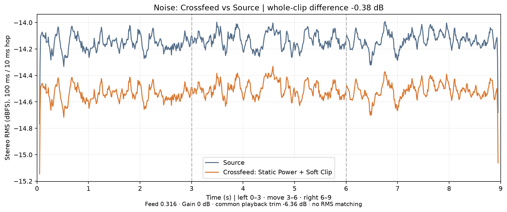
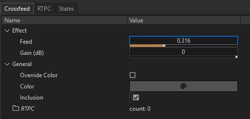

# Crossfeed（Wwise · Windows x64）

Crossfeed 是基于滤波、短延迟与静态功率归一化的 Wwise 耳机总线效果器，用较低的运算成本缓解游戏 3D 点声源 hard pan 带来的单耳堵塞感。

内置 Soft Clip，限制过高的输出采样峰值，减少数字硬削波风险。

## I. 听感对比

戴上耳机，保持播放器音量不变，依次试听：


- [source音频](https://github.com/user-attachments/files/34624749/source.wav)
- [crossfeed.wav](https://github.com/user-attachments/files/34625010/crossfeed.wav)
- [spread-10dB.wav](https://github.com/user-attachments/files/34625024/spread-minus10dB.wav)


- **声源轨迹**　同一段白噪声、同一条 Wwise 定位轨迹：左侧停留 3 秒，经正前方移向右侧 3 秒，再在右侧停留 3 秒。
- **效果设置**　Crossfeed 使用默认 Feed 0.316、Gain **0 dB**；Spread 版本不经过 Crossfeed，两端对侧比主侧低约 10 dB。三份试听使用相同的整体播放衰减。
- **结果**　本段整段立体声 RMS 仅下降约 **0.38 dB**，电平差异较小。



## II. 使用方法

### 一、在立体声总线上添加效果

1. 将需要处理的 3D 声源路由到同一个 Audio Bus，把总线声道配置设为 **Stereo（2.0）**。单声道素材先由 Wwise 完成 3D 定位，再混入总线。
2. 在总线的 **Effects** 插槽添加 **Crossfeed**。
3. 把测试声源放到角色正左或正右，戴上耳机切换 **Bypass**，比较另一侧耳朵听到的声音。

### 二、输入与输出

- **采样率**　8–192 kHz。
- **声道**　Mono → Mono，Stereo → Stereo。上述耳机用法采用 Stereo → Stereo。

### 三、效果参数

下图为新建效果时的默认设置。已有效果保存的 Gain 值保持不变。



| 参数 | 默认值 | 范围 | 作用 |
|---|---:|---:|---|
| Feed | 0.316 | 0–1 | 控制对侧混入量。默认时，低频对侧/直达约 −10 dB，高频更轻。调大可增强串音；设为 0 仍保留 Gain 和峰值保护，完全关闭请用 Bypass。 |
| Gain (dB) | 0 dB | −6～0 dB | 静态功率归一化之后、Soft Clip 之前的共同增益。默认不额外衰减；需要降低输出电平时再调低。 |

Soft Clip 在采样峰值超过 0.85 时平滑压缩，输出采样幅度限制在约 0.98 以内。高电平时会改变波形；它不消除素材本身的点击声，也不保证后续混音或重建后的真峰值不超限。

## III. 安装预编译版本

### 一、选择版本

1. 下载并解压仓库 ZIP。
2. 按 Wwise 和游戏集成的完整版本号选择目录。下表为 Windows x64 构建，其他同分支补丁版需自行验证。

| 目录 | 构建所用 Wwise 版本 |
|---|---|
| `release/2019/` | 2019.2.15.7667 |
| `release/2023/` | 2023.1.17.8841 |
| `release/2025/` | 2025.1.8.9170 |

另保留一份使用 UE Wwise Integration 2025.1.8.9170 SDK 头文件构建的 DLL：`release/integration/2025.1.8.9170/Crossfeed.dll`。这是 2026-11-05 的独立构建，与上述 2026-11-10 发布的 Runtime DLL 不同，不代表最新源码产物；一般安装请使用对应年份的 `Runtime/Crossfeed.dll`。

### 二、安装到 Wwise

1. 保存并关闭 Wwise 和 WwiseConsole。若已安装过 Crossfeed，先备份插件目录中的同名文件。
2. 将所选年份 `Authoring/` 中的 `Crossfeed.dll` 和 `Crossfeed.xml` 一起复制到 Wwise 安装目录下的 `Authoring/x64/Release/bin/Plugins/`。复制时需要该目录的写入权限。例如，Wwise 2023.1.17 使用 `release/2023/Authoring/` 中的两个文件。
3. 重新打开 Wwise，在 Audio Bus 的 **Effects** 插槽中确认可以选择 **Crossfeed**。

### 三、安装到游戏项目（可选）

1. 关闭游戏编辑器，找到同一年份的 `Runtime/Crossfeed.dll`。
2. 按下表将 DLL 复制到游戏项目的 Wwise Integration 中。

| 引擎 | 目标目录（相对于游戏项目根目录） |
|---|---|
| Unreal Engine | `Plugins/WwiseSoundEngine/ThirdParty/x64_vc170/Profile/bin/` 和 `Plugins/WwiseSoundEngine/ThirdParty/x64_vc170/Release/bin/`，两处都要复制 |
| Unity | `Assets/Wwise/API/Runtime/Plugins/Windows/x86_64/DSP/` |

- **Unreal Engine**　按项目已有的插件名和工具链目录调整路径。较早版本可能使用 `Plugins/Wwise` 和其他 `x64_vc*` 目录。
- **Unity**　部分版本使用 `Deployment` 代替 `API/Runtime`。若已有的 `x86_64` 目录下缺少 `DSP`，先创建该目录。复制后，确认 DLL 导入设置已启用 Windows x86_64。

**安装验证**　重新生成 Windows SoundBanks 并同步到游戏项目，确认游戏运行日志中没有 Crossfeed 插件缺失错误。

## IV. 从源码编译安装

### 一、准备构建环境

- **Wwise SDK**　在 Audiokinetic Launcher 中安装目标版本的 Wwise 和同版 SDK。
- **C++ 工具链**　安装 Visual Studio 2022 或 Build Tools，选择“使用 C++ 的桌面开发”、MSVC x64/x86 工具和 Windows SDK。构建 Wwise 2019 版本还需安装对应工具集的 C++ ATL。
- **Python 3**　在 PowerShell 中运行 `python --version`，确认能显示版本号。

### 二、编译、测试并安装到 Wwise

1. 克隆仓库或下载并解压 ZIP，保留目录结构。在包含 `build.ps1` 和 `src` 的仓库根目录打开 PowerShell。
2. 将示例路径换成自己的 Wwise 安装目录（应包含 `Authoring` 和 `SDK`），依次编译并测试。

   ```powershell
   $WwiseInstall = "C:\Program Files (x86)\Audiokinetic\Wwise2023.1.17.8841"
   .\build.ps1 -WwiseRoot $WwiseInstall
   .\test.ps1 -WwiseRoot $WwiseInstall
   ```

   测试会用对应版本的 Runtime DLL 验证 Bank 参数读取和 5 ms 收尾。Wwise 2019.2.15 还会检查 Authoring 写出的完整 9 字节参数块。

3. 看到 `Crossfeed tests PASSED` 后，保存并关闭 Wwise 和 WwiseConsole。在对安装目录有写入权限的 PowerShell 中运行：

   ```powershell
   .\install.ps1 -WwiseRoot $WwiseInstall -Authoring -Apply
   ```

4. 重新打开 Wwise，在 Audio Bus 的 **Effects** 插槽中确认可以选择 **Crossfeed**。

### 三、安装到游戏项目（可选）

1. 确认游戏项目的 Wwise Integration 与构建用 SDK 匹配。关闭 Wwise 和游戏编辑器，保留刚才的 PowerShell 窗口。
2. 按使用的引擎选择下面一组命令，将示例路径换成自己的项目路径。

   **Unreal Engine**　选择已有的 Windows x64 工具链目录，确认 Profile 和 Release 的两个 `bin` 目录都存在。较早版本可能使用 `Plugins\Wwise` 和其他 `x64_vc*` 目录。

   ```powershell
   $Platform = "C:\Projects\MyGame\Plugins\WwiseSoundEngine\ThirdParty\x64_vc170"
   $PluginDirs = @("$Platform\Profile\bin", "$Platform\Release\bin")
   ```

   **Unity**　在已有的 Windows `x86_64` 插件目录下选择 `DSP` 子目录，若缺少则先创建。部分版本使用 `Deployment` 代替 `API\Runtime`。

   ```powershell
   $PluginDirs = @("C:\Projects\MyGame\Assets\Wwise\API\Runtime\Plugins\Windows\x86_64\DSP")
   ```

3. 在同一窗口运行安装命令。

   ```powershell
   .\install.ps1 -WwiseRoot $WwiseInstall -RuntimeBinDirectories $PluginDirs -Apply
   ```

4. 确认每个目标目录中都有 `Crossfeed.dll`。Unity 项目可能还需检查 DLL 的 Windows x86_64 导入设置。重新生成 Windows SoundBanks 并同步到游戏项目。

## V. 版本迁移

1. 下载并安装目标版本的 Wwise。
2. **首次用新版 Wwise 打开旧工程前**，先将匹配该版本的 Crossfeed Authoring 插件安装到新版 Wwise 的插件目录。
3. 用新版 Wwise 打开旧工程并执行迁移，确认原有效果及参数可被识别。

已验证 Wwise 2019.2.15 → 2025.1.8：测试工程原有的 Crossfeed 效果及参数值在迁移后得到保留。
